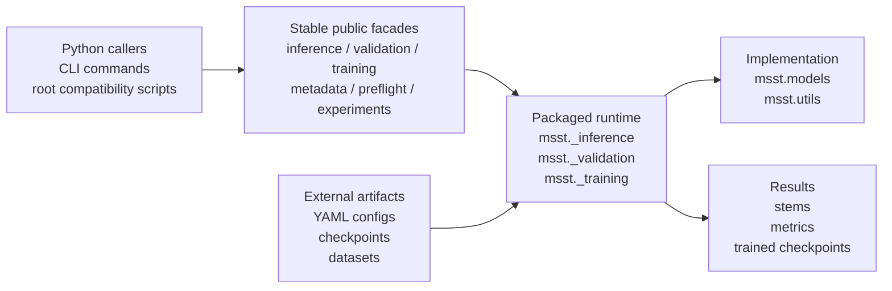

# Package architecture and upstream maintenance

MSST is distributed from this repository; it is not a second copy of the
project and it does not install a pinned Git checkout at runtime. Keeping the
package and training repository in one source tree lets every upstream model,
dataset, and inference fix be tested through both the scripts and the Python
API before one release is built.

## Source layout

- `msst/` is the only installed Python namespace and owns all runtime code.
- `msst/models/` and `msst/utils/` contain model, dataset, configuration, and
  support implementations.
- `msst.inference`, `msst.validation`, `msst.training`, `msst.metadata`,
  `msst.preflight`, and `msst.experiments` are stable public facades. Internal
  implementations use a leading underscore until their APIs are stabilized.
- Repository-level scripts such as `inference.py` and `train.py` are thin
  compatibility entry points. They are not included in the wheel.
- Repository-level `models` and `utils` packages are temporary source-checkout
  aliases. New code must import `msst.models` or `msst.utils` directly.

There must be one implementation of each runtime feature. A compatibility
entry point may delegate to `msst`, but must not carry a forked copy of the
implementation.

Metadata collection follows this rule explicitly: `msst.build_metadata`,
`msst metadata`, `scripts/do_metadata.py`, and the training DataLoader all use
`MSSDataset.collect_metadata`. DDP permits only rank zero to write the cache.

The three training launchers share one argument parser and canonical batch /
loss step. `standard` owns CPU, single-GPU, and DataParallel; `ddp` owns
DistributedDataParallel; `accelerate` preserves the Accelerate runtime. Only
rank zero writes the main DDP stream, while other rank logs remain available
for diagnosis.

## Upstream update policy

The preferred long-term outcome is to merge the package layout into the
ZFTurbo repository and release PyPI artifacts from that repository. Until that
happens, maintain the package work in a fork with two remotes: `upstream` for
ZFTurbo and `origin` for the publishing fork.

For each upstream update:

1. Fetch `upstream/main` and create a short-lived integration branch from the
   last package release.
2. Merge or rebase onto `upstream/main`. Translate changes made to historical
   root runtime paths into their `msst/` locations; do not restore duplicate
   implementations.
3. Run the full tests, distribution inspection, and an installed-wheel smoke
   test outside the checkout.
4. Merge the integration branch. Release only when a package change is needed;
   an upstream commit does not automatically require a PyPI release.

Keep packaging and namespace moves in focused commits. Model research changes
should remain separately reviewable so they can be compared or contributed
upstream without pulling release mechanics into the same diff.

## Release boundaries

Python code follows semantic versioning. Backward-compatible bug fixes use a
patch release, additive public API uses a minor release, and incompatible
public API or checkpoint-format changes require a major release (or a new
pre-1.0 minor release).

Configs and checkpoints are independently versioned model artifacts and are
never bundled in the wheel. See [model artifact versioning](model_artifacts.md)
for their manifest and compatibility rules.
